# CS Agent

CS Agent 是一个可适配多种业务领域的智能客服框架。客户消息由统一入口受理，LangGraph 运行时再根据请求性质选择确定性规则、FAQ、SOP、RAG、澄清、人工接管或安全退出。需要生成的知识型回复只形成坐席草稿，经过人工审核后才会发送给客户。

仓库提供应用源码、数据库迁移、通用内容样例与本地容器编排，不附带真实客户数据、业务知识文档或生产账号。接入方可以在保持主链路不变的情况下替换客户数据适配器、已发布内容和模型供应商。

## 系统结构





| 组件 | 职责 | 代码入口 |
| --- | --- | --- |
| Workbench | 客户咨询页与坐席工作台 | [`frontend/workbench`](frontend/workbench) |
| Nginx | TLS、静态资源与反向代理 | [`infra/docker/nginx`](infra/docker/nginx) |
| BFF | 登录鉴权、对象授权、幂等受理、消息落库、SSE 与输出门 | [`services/bff`](services/bff) |
| AI Runtime | LangGraph 编排、上下文、意图路由、FAQ、SOP、RAG 与安全边界 | [`services/ai_runtime`](services/ai_runtime) |
| Customer Data | 通用客户资料与服务记录适配器 | [`services/customer_data`](services/customer_data) |
| Content | FAQ、意图、SOP 与 RAG 内容的审核、发布和活动版本管理 | [`services/content`](services/content) |
| Quality | 异步质量记录与运行结果观察 | [`services/quality`](services/quality) |

PostgreSQL 保存应用事实、发布内容、审核记录和 LangGraph checkpoint；Redis 保存活动版本指针及精确查询投影；Milvus 保存可重建的意图、FAQ 与 RAG 向量索引。

## 核心边界

- FAQ 命中后读取已发布答案包，并检查版本与适用范围。
- SOP 负责有状态的槽位收集、确认和人工闸门；默认示例不执行外部系统写操作。
- FAQ 确认没有候选且满足准入条件时，才允许进入 RAG。
- RAG 默认关闭，仓库也不预置知识语料；启用前必须自行发布语料并构建索引。
- RAG 草稿只进入坐席审核面板，不会绕过输出门直接发送给客户。
- 不确定、证据不足、内容冲突或受保护操作不会被包装成确定答案。
- Jev 可作为旁路观察器与基线决策链对比，默认不决定真实业务路由。

## 环境要求

- Docker Desktop，或兼容的 Docker Engine 与 Compose；
- [uv](https://docs.astral.sh/uv/)；
- Node.js 与 npm；
- OpenSSL；
- CPython 3.11～3.13。

首次构建会下载 Python 依赖、前端依赖、容器镜像和嵌入模型，耗时与磁盘占用取决于本机缓存和网络环境。

## 配置

```bash
cp .env.example .env
```

至少应替换以下值：

- `BFF_JWT_SECRET`、`AI_RUNTIME_INTERNAL_TOKEN`；
- `POSTGRES_PASSWORD`、`MINIO_ROOT_PASSWORD`；
- `DATABASE_URL` 中对应的数据库密码；
- `LLM_API_KEY`。

`.env` 已被 Git 忽略，不应提交真实密钥。默认配置关闭 RAG；需要启用时，还需准备已审核知识内容、构建索引并配置相应的生成与精排服务。

## 初始化与启动

```bash
uv sync --frozen
./scripts/runtime/start.sh
```

启动入口依次完成基础设施启动、数据库迁移、通用 FAQ/意图/SOP 内容发布、Milvus 语义索引构建、前端构建和应用服务启动。

访问地址：

- HTTP：<http://localhost:8080>（跳转到 HTTPS）；
- HTTPS：<https://localhost:8443>。

本地使用自签名证书，浏览器首次访问会显示证书提示。停止服务：

```bash
./scripts/runtime/stop.sh
```

## 准备客户数据与账号

数据库结构的权威来源是 Alembic 迁移和客户数据模型：

- [`infra/db/migrations/versions/0002_business_core.py`](infra/db/migrations/versions/0002_business_core.py)
- [`services/customer_data/infrastructure/models.py`](services/customer_data/infrastructure/models.py)

仓库不会自动写入客户记录和登录账号。建议按以下顺序准备：

1. 执行数据库迁移；
2. 写入客户资料与通用服务记录；
3. 创建登录主体、角色及客户授权关系；
4. 通过应用接口创建会话并发送消息。

客户身份示例：

```bash
.venv/bin/python -m scripts.bootstrap.create_identity \
  --subject-id <subject-id> \
  --username <username> \
  --role CUSTOMER \
  --customer-id <existing-customer-id>
```

坐席身份示例：

```bash
.venv/bin/python -m scripts.bootstrap.create_identity \
  --subject-id <subject-id> \
  --username <username> \
  --role AGENT \
  --customer-id <assigned-customer-id>
```

命令会在终端交互读取密码。一个坐席可重复关联多个已存在的客户编号。

## 默认内容

仓库只保留启动演示所需的通用内容：

- [`data/knowledge/faq_variants.json`](data/knowledge/faq_variants.json)：通用 FAQ 的语义问法；
- [`scripts/bootstrap`](scripts/bootstrap)：空环境下的审核、发布与索引构建实现；
- [`scripts/bootstrap_all.py`](scripts/bootstrap_all.py)：统一初始化入口。

知识文档、RAG 父子块和行业数据由部署方自行提供。默认初始化不会生成客户记录、登录账号或行业知识库。

## 常用检查

```bash
# 查看服务状态
docker compose --env-file .env -f infra/docker/compose.yaml --profile app ps

# 查看数据库迁移头
uv run alembic heads

# 检查 Python 代码
uv run ruff check services shared prompts scripts infra/db/migrations

# 构建前端
npm --prefix frontend/workbench ci
npm --prefix frontend/workbench run build
```

排查问题时应同时核对 BFF、AI Runtime、Customer Data、Quality、PostgreSQL、Redis 与 Milvus，不要只根据页面提示猜测根因。

## 目录

```text
assets/                 README 架构图
data/knowledge/         通用 FAQ 语义问法
frontend/workbench/     Vue 客户页与坐席工作台
infra/db/               Alembic 数据库迁移
infra/docker/           本地容器、Nginx 与基础设施配置
prompts/                各模型环节的集中提示词
scripts/bootstrap/      空环境内容初始化实现
scripts/maintenance/    运行维护与重建工具
scripts/runtime/        启停入口
services/               各应用服务
shared/                 跨服务契约和公共基础能力
```

## 分支工作流

- `dev` 是日常开发分支，功能修改先提交并推送到 `dev`；
- 完成代码审查与验证后，再通过 Pull Request 或受控合并进入 `main`；
- `main` 只保留已经通过审核、可以部署或发布的版本；
- 不在 `main` 上直接开发，不向任一分支提交密钥、运行日志或本地缓存。

## 安全与生产部署

本地 Compose 便于开发和单机验证，不等同于生产部署方案。生产环境至少还需要：

- 使用密钥管理服务、正式证书、网络隔离和最小权限账号；
- 对客户数据、外部模型和决策服务建立授权、审计与数据出域审批；
- 配置监控告警、备份恢复、容量规划、灰度发布与回滚；
- 使用自身内容和真实流量重新校准检索阈值与安全边界；
- 对接正式业务系统时，为写操作补齐幂等、状态查询、补偿与人工复核。

## License

本项目采用 [Apache License 2.0](LICENSE)。
